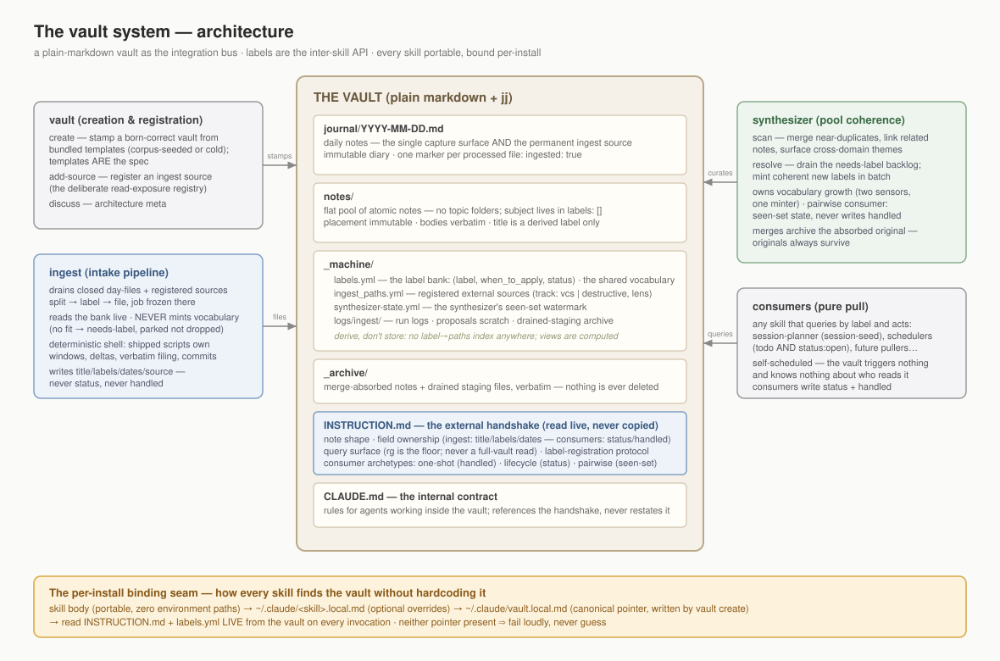
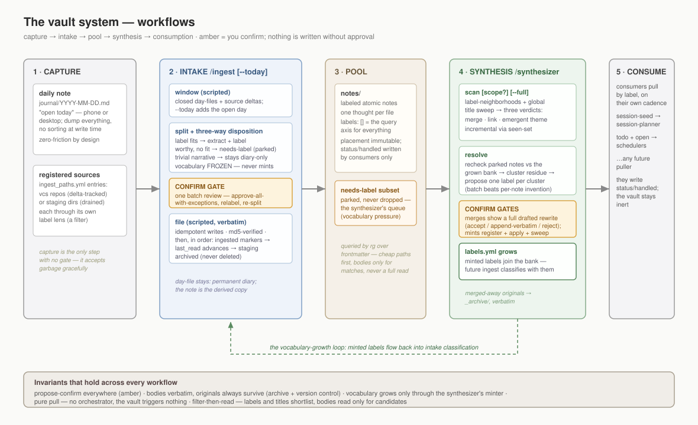

# The vault system

A portable personal knowledge system built on a plain-markdown vault — three linked materia
(**vault**, **ingest**, **synthesizer**) plus any consumer skill that queries it.

The vault itself is deliberately simple: a flat pool of atomic notes organized by a controlled
label vocabulary instead of folders, a `journal/` of daily notes that doubles as the capture
surface and the permanent ingest source, and a thin machine layer (`_machine/`) holding the label
bank, the label proposals, the routing rules and the source registry. The vault owns all of them and
depends on nothing outside itself and this plugin. Everything an external skill needs to integrate lives in the vault's
own `INSTRUCTION.md` (read live, never copied) — which is why every skill here stays portable.

## The three materia

| Materia | Role | Subcommands |
|---------|------|-------------|
| **vault** (the anchor skill) | Creation & registration | `create` (stamp a born-correct vault from the `assets/` templates — corpus-seeded or cold), `add-source` (register an external ingest source), `discuss` (architecture meta) |
| **ingest** | Intake | `[source?] [--today] [--silent]` (drain closed journal day-files + registered sources: split → label → route → file through one confirm gate), `status` (read-only health, including undelivered actionables) |
| **synthesizer** | Pool coherence & vocabulary growth | `scan [scope?] [--full]` (propose merges and links; open label proposals for emergent themes), `resolve` (the label review sitting: accept, reject, revise, rename or merge each proposal, then sweep accepted labels onto pending and earlier notes) |

Consumers — session-planner today, any future puller — query notes by label on their own cadence.
The vault stays inert: it triggers nothing and knows nothing about who reads it.

## Label proposals

**Ingest proposes, review accepts.** Write `label:: <name>` in a journal thought to ask for a label;
ingest applies it if it exists, and otherwise opens a proposal in `_machine/label-proposals.yml` with
the thought as evidence and parks the note under `needs-label`. Ingest also opens implicit proposals
when no subject label fits, and attaches thoughts that fit an open one. `--silent` writes proposals but
never accepts. `/synthesizer resolve` is the review: explicit proposals and any with two or more
evidence records are presented (single-record implicit ones wait, never expiring); an accepted label
enters the bank in the same commit that deletes its proposal, and a rejected name is remembered so
ingest does not reopen it. At ingest's interactive gate an explicit request can be accepted on the spot.

## Routing and adapters

`_machine/routing.yml` maps label matches to named targets; each target names the adapter that
delivers to it. An adapter is an executable shipped in `skills/ingest/scripts/adapters/` that takes
one labelled thought as JSON and answers `{status: delivered, landed}` or `{status: failed, reason}`.
The plugin ships one, `notes` (the vault copy, whose slug is every thought's id). Delivery to any
other system stays off until an adapter for it ships; meanwhile `ingest status` lists undelivered
actionables (an action label, no `outcome`) and `note-outcome` closes one.

## Shared scripts

`scripts/` holds the vault-level code every skill shares: `label-bank` (the bank's sole writer),
`label-proposals` (the proposal bank's sole writer; `accept` is one commit over both banks),
`relabel-notes` (bulk `labels` rewrites, body-md5 checked, one commit), the bank, proposal and
routing schemas, and the frontmatter and transaction modules. Tests:

```sh
python3 -m unittest discover plugins/vault/scripts/tests
python3 -m unittest discover plugins/vault/skills/ingest/scripts/tests
for t in plugins/vault/skills/ingest/scripts/tests/test-*.sh; do bash "$t"; done
```

## Architecture

What exists, and who owns which field:



## Workflows

What happens, from capture to consumption. Amber marks the confirm gates — nothing is written
without approval:



## Lifecycle quickstart

1. **`/vault create [corpus-path?]`** — stamp a vault (from an exported-notes corpus, or cold).
   Writes the canonical pointer `~/.claude/vault.local.md`; every other skill finds the vault
   through it.
2. **Capture** — dump everything into today's daily note (`journal/YYYY-MM-DD.md`), phone or
   desktop. No sorting, no tags, no friction.
3. **`/ingest`** — when you feel like it, drain the closed days (and any registered sources) into
   labeled atomic notes. `--today` includes the open day so same-day actionables aren't blocked.
4. **`/synthesizer scan`** / **`/synthesizer resolve`** — periodically: merge near-duplicates,
   link related notes, and review the label proposals ingest and scan opened.
5. **Consume** — skills pull by label (`session-seed`, `todo AND status:open`, …) and act.

## Contracts (defined once, in the vault)

The authoritative integration contract is the stamped `INSTRUCTION.md` — see
[`skills/vault/assets/INSTRUCTION.md`](skills/vault/assets/INSTRUCTION.md), which is the template
every vault is born with.
Highlights:

- **Field ownership:** ingest writes `title`/`labels`/dates/`source`/`routed_to`; `note-outcome`
  writes `outcome`/`resolved`; `labels` after creation change only through `relabel-notes` on a
  confirmed pass, `label-bank rename`, ingest's interactive gate, or the human. A proposed name is
  never written to a note before acceptance.
- **Consumer archetypes:** one-shot (`handled` mark-all-seen), lifecycle (`status` filter),
  pairwise (seen-set watermark — the synthesizer).
- **Query surface:** ripgrep over frontmatter is the required floor; never a full-vault read.
- **Binding:** every skill resolves `~/.claude/<skill>.local.md` → `~/.claude/vault.local.md` →
  fails loudly. No skill hardcodes a vault path.

## Design history

The full design record (specs, decision diagrams, implementation plans) lives in the marketplace
repo at [`docs/superpowers/`](https://github.com/TuckerMoses/claude-materia/tree/main/docs/superpowers)
— see the `vault-skill`, `synthesizer-skill`, and `ingest-skill` documents. (Absolute URL so the
link survives a standalone plugin install.)
